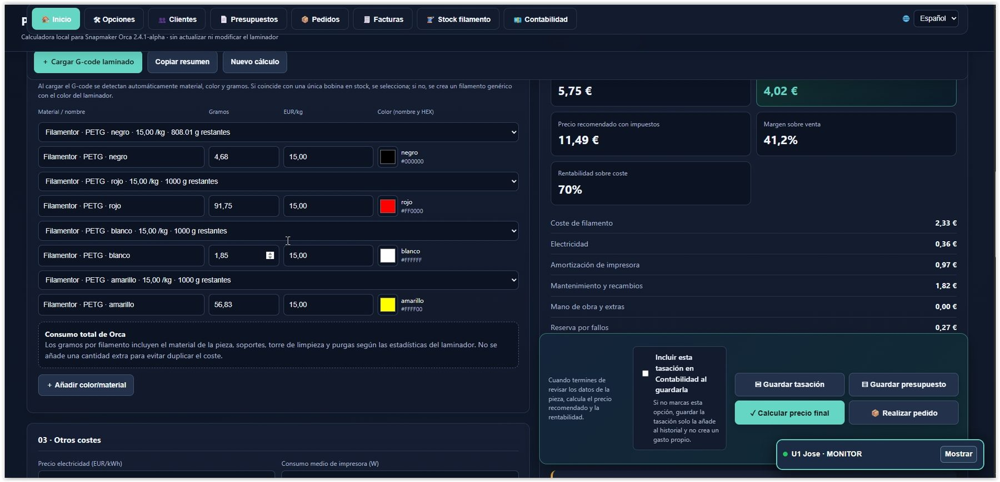
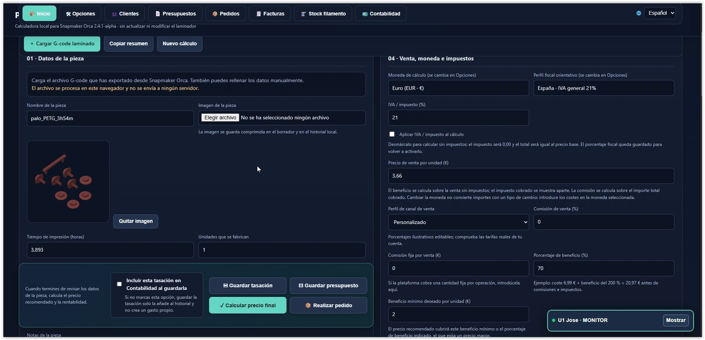
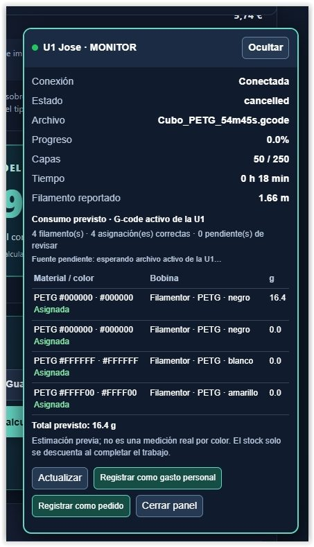
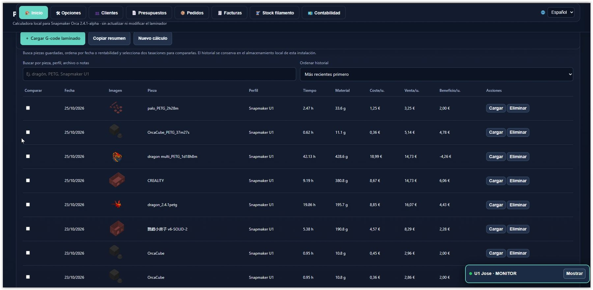
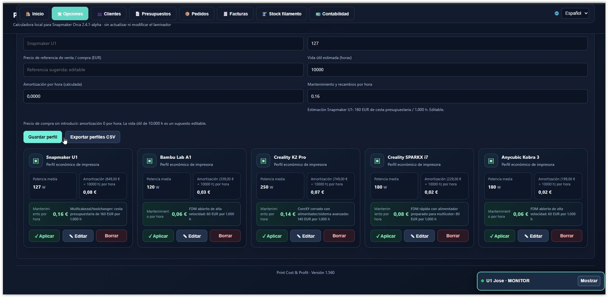
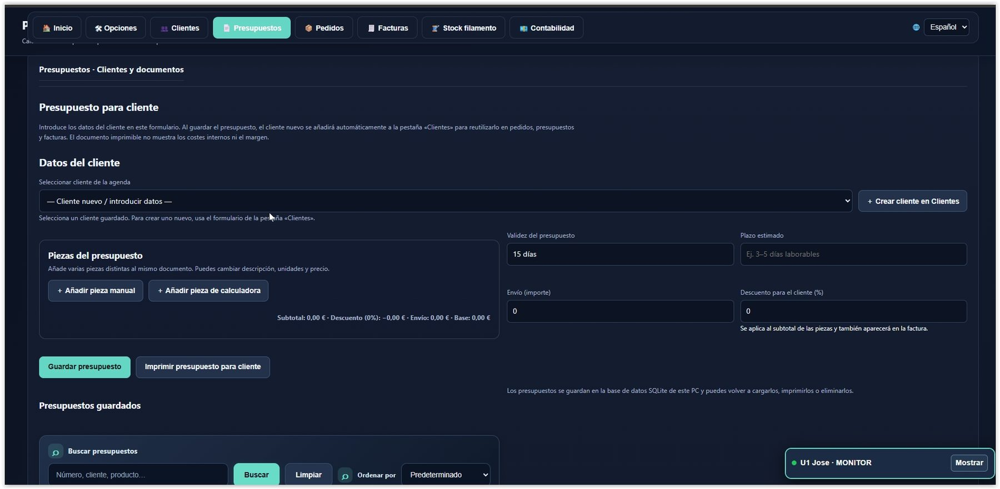
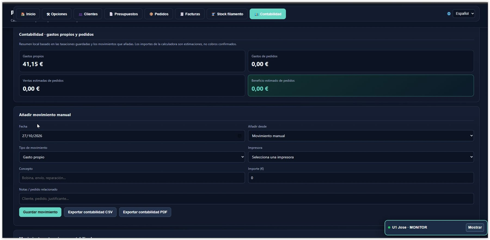
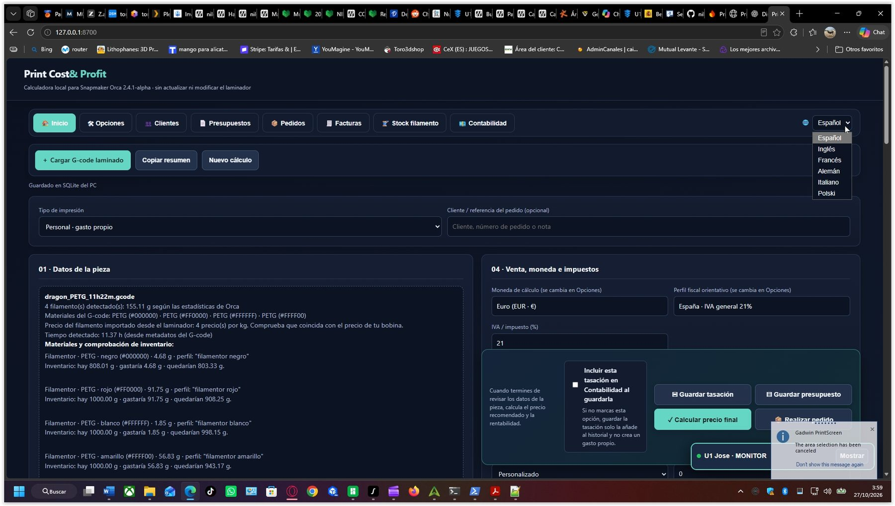

****# Print Cost & Profit v1.0

## Calculadora de costes, producción y gestión para impresión 3D

Print Cost & Profit es una aplicación diseñada para ayudar a los usuarios de impresión 3D a calcular los costes reales de fabricación, controlar el consumo de filamento, gestionar materiales y organizar la actividad comercial relacionada con sus impresiones.

La aplicación integra una calculadora de costes con herramientas de gestión, almacenamiento local e integración con laminadores basados en OrcaSlicer, especialmente Snapmaker Orca, OrcaSlicer y Creality Print. También incluye un monitor para impresoras compatibles, con distintos niveles de compatibilidad según el modelo y la conexión disponible.

## Capturas de la aplicación

A continuación se muestran algunas pantallas de Print Cost & Profit. Las imágenes ilustran distintas áreas de la interfaz; las funciones disponibles dependen de la versión y de la configuración instalada.

**Autoría:** Beatriz Toro Martin &#x20;

**Versión publicada:** v1.0 &#x20;

**Sistema operativo de referencia:** Windows 10 y Windows 11 &#x20;

**Repositorio oficial:** https\://github.com/nilose2014/PrintCostProfit

---

# 1. Características principales

## 1.1. Calculadora de costes de impresión 3D

La calculadora permite estimar el coste de fabricación de una pieza a partir de los parámetros de impresión y los costes asociados.

Entre los conceptos de coste que se pueden utilizar, según la configuración disponible, se encuentran:

- Consumo de filamento.

- Precio del material utilizado.

- Tiempo de impresión.

- Coste de funcionamiento y desgaste de la impresora.

- Amortización del equipo.

- Otros gastos asociados a la fabricación.

- Margen de beneficio deseado.

- Impuestos y moneda seleccionados.

El objetivo es conocer cuánto cuesta fabricar una pieza antes de decidir su precio de venta.

## 1.2. Precio de venta, beneficio y margen

La calculadora permite estudiar el resultado económico estimado de una impresión.

Los cálculos ayudan a distinguir entre:

- **Coste de fabricación:** importe estimado de los recursos utilizados.

- **Precio de venta:** cantidad que se plantea cobrar por la pieza.

- **Beneficio estimado:** diferencia calculada entre los ingresos y los costes considerados.

- **Margen:** relación entre el beneficio y el precio de venta, según la definición empleada por el cálculo.

- **Precio recomendado:** propuesta de precio calculada a partir de los parámetros configurados.

Los resultados dependen de los precios, porcentajes, tiempos y demás valores introducidos. Para obtener estimaciones útiles, conviene mantener actualizados los costes del filamento, la impresora y los gastos adicionales.

## 1.3. Perfiles de impresora

Los perfiles permiten configurar los parámetros económicos asociados a los equipos utilizados.

Pueden servir para tener en cuenta datos como el coste de adquisición, la vida útil estimada y los costes de funcionamiento cuando estén contemplados en el perfil.

Si se utilizan varias impresoras, es importante seleccionar el perfil adecuado para que las estimaciones reflejen las diferencias entre equipos.

## 1.4. Compatibilidad con laminadores

La integración está diseñada para laminadores basados en OrcaSlicer, especialmente **Snapmaker Orca, OrcaSlicer y Creality Print**. La compatibilidad con estos laminadores está aproximadamente al **90 %**; todavía puede haber diferencias de comportamiento según la versión y la configuración. Por tanto, no debe describirse como una compatibilidad del 100 %.

La integración mediante scripts de posprocesamiento permite procesar archivos G-code generados por el laminador y utilizar los datos disponibles en el flujo de trabajo de Print Cost & Profit. La información recuperable depende del archivo, de la configuración y de la versión del laminador.

## 1.5. Monitor y compatibilidad con impresoras

La impresora con compatibilidad confirmada al **100 %** es la **Snapmaker U1**. El monitor también funciona con otras impresoras, incluidas las que permiten acceder a través de **Fluidd** o **Mainsail/Moonraker** (según la configuración), pero la compatibilidad de esos modelos todavía está en fase de ajuste. Algunas funciones pueden no estar disponibles o comportarse de forma diferente mientras continúan las pruebas.

## 1.6. Almacenamiento local SQLite

La aplicación incluye componentes de almacenamiento local mediante SQLite.

El objetivo es conservar los datos en una base de datos del ordenador y evitar que se repartan entre el almacenamiento del PC y el del navegador.

Si el almacenamiento local no puede iniciarse, la aplicación debe mostrar el error correspondiente en lugar de cambiar silenciosamente a otro almacenamiento.

## 1.7. Herramientas de diagnóstico

El proyecto incluye scripts para ayudar a comprobar el inicio de la aplicación, el funcionamiento del puente local y determinados problemas de integración.

Estas herramientas permiten obtener información útil cuando un componente no se inicia o una operación no termina correctamente.

---

# 2. Requisitos previos

Antes de iniciar el programa, se recomienda disponer de:

- Un ordenador con Windows 10 o Windows 11.

- Una carpeta local permanente para instalar el proyecto.

- Un laminador basado en OrcaSlicer —especialmente Snapmaker Orca, OrcaSlicer o Creality Print— si se desea utilizar la integración.

- Los archivos completos de la distribución descargada.

- Los componentes de almacenamiento y configuración incluidos en el paquete de distribución.

La distribución debe incluir el ejecutable de SQLite preparado para Windows para evitar que el usuario final tenga que instalar Python manualmente.

No ejecutes la aplicación directamente desde el archivo ZIP. Extrae primero todos los archivos.

---

# 3. Descargar e instalar Print Cost & Profit

## Paso 1. Descargar el programa

1. Abre el repositorio oficial:

   https\://github.com/nilose2014/PrintCostProfit

2. Pulsa **Code**.

3. Selecciona **Download ZIP**.

4. Espera a que finalice la descarga.

5. Extrae el contenido del ZIP.

## Paso 2. Elegir la carpeta

Puedes utilizar una carpeta como:

`C:\PrintCostProfit`

También puedes escoger otra ubicación permanente. Evita utilizar carpetas temporales y no muevas el programa después de configurar las rutas de OrcaSlicer, salvo que actualices dichas rutas.

## Paso 3. Iniciar el programa

Abre la carpeta donde has extraído los archivos y haz doble clic en:

**`Integracion_Orca_Postprocesado.bat`**

Este archivo sirve tanto para el inicio manual como para la integración con OrcaSlicer.

Cuando se ejecuta manualmente, comprueba si el servicio local está disponible. Si no responde, intenta iniciarlo y espera a que esté preparado antes de abrir la interfaz en el navegador.

No necesitas abrir primero el archivo HTML ni iniciar por separado el puente local cuando el lanzador puede encargarse de ello.

**Importante:** para utilizar las funciones que necesitan almacenamiento local, inicia la aplicación mediante este archivo y no abriendo directamente `Print_Cost_Profit.html`.

---

# 4. Configurar un laminador basado en OrcaSlicer

La integración está pensada para laminadores basados en OrcaSlicer, especialmente Snapmaker Orca, OrcaSlicer y Creality Print. Los nombres de menús y algunos detalles pueden variar entre ellos. La compatibilidad general está aproximadamente al 90 %, por lo que conviene realizar una prueba con la versión instalada.

La integración utiliza el script de posprocesamiento para procesar el G-code cuando el laminador termina de laminar.

## Paso 1. Localizar el archivo de integración

En la carpeta del programa, localiza:

`Integracion_Orca_Postprocesado.bat`

Copia su ruta completa. Si has utilizado la carpeta de ejemplo, será:

`C:\PrintCostProfit\Integracion_Orca_Postprocesado.bat`

Si has instalado el programa en otra ubicación, utiliza la ruta real.

## Paso 2. Abrir los ajustes de impresión

1. Abre OrcaSlicer.

2. Selecciona el perfil de impresora que deseas utilizar.

3. Entra en los ajustes de impresión.

4. Activa el modo avanzado o experto si es necesario.

5. Abre la sección **Otros**.

6. Localiza el apartado **Scripts de posprocesamiento**.

Los nombres y la disposición de los menús pueden variar según el laminador, su versión y el idioma seleccionado.

## Paso 3. Añadir el script

Introduce la ruta completa de:

`Integracion_Orca_Postprocesado.bat`

Guarda los ajustes del perfil.

Si tu laminador necesita una sintaxis concreta para las rutas o los argumentos, utiliza el formato correspondiente a esa versión.

## Paso 4. Realizar una prueba

1. Carga un modelo sencillo.

2. Selecciona la impresora y el perfil de impresión.

3. Configura el material.

4. Lamina el modelo.

5. Exporta el G-code.

6. Comprueba que el posprocesamiento se ejecuta sin errores.

El script procesa el archivo G-code cuando OrcaSlicer lo llama con la ruta del archivo. En ese caso, el comportamiento es distinto del inicio manual: procesa el archivo y termina sin abrir una segunda ventana de la aplicación.

---

# 5. Procesamiento de archivos G-code

El G-code contiene instrucciones que el laminador genera para la impresora 3D.

La integración de Print Cost & Profit permite procesar estos archivos para recuperar los datos disponibles que resulten útiles para el cálculo y el registro de trabajos.

Según la información presente en el archivo y las funciones disponibles, pueden resultar relevantes datos como:

- Nombre o ruta del archivo.

- Información de impresión generada por el laminador.

- Datos estimados de tiempo y consumo de material.

- Información de filamentos cuando está disponible.

Los valores procedentes del G-code son estimaciones del laminado. No deben confundirse automáticamente con el consumo real confirmado por la impresora.

## Prueba manual con un G-code

El proyecto incluye:

`Probar_Integracion_con_Gcode.bat`

Para realizar una prueba:

1. Localiza un archivo G-code generado por el laminador compatible que estés utilizando.

2. Arrastra el archivo sobre `Probar_Integracion_con_Gcode.bat`.

3. Espera a que termine el proceso.

4. Comprueba el resultado y cualquier mensaje de error.

Esta prueba ayuda a distinguir entre un problema del procesamiento del archivo y un problema del servicio local.

---

# 6. Gestión de costes y rentabilidad 

Para obtener resultados útiles, conviene configurar los datos económicos antes de calcular el precio de una pieza.

## Filamento

Mantén actualizado el precio de cada material utilizado. Una variación en el precio por kilogramo puede modificar significativamente el coste de las piezas fabricadas.

## Impresora

Utiliza el perfil del equipo con el que se va a fabricar la pieza. Los parámetros de amortización y desgaste deben basarse en estimaciones razonables de coste y vida útil.

## Tiempo de fabricación

El tiempo previsto por el laminador permite estimar el coste asociado al uso de la máquina. El resultado real puede variar por pausas, cambios de material, fallos o diferencias entre el tiempo estimado y el efectivo.

## Gastos adicionales

Incluye los gastos que correspondan al trabajo y que estén contemplados en la configuración de la calculadora.

## Precio de venta

Revisa el precio recomendado junto con el coste, el beneficio y el margen. Un precio calculado solo es fiable en la medida en que los datos introducidos sean adecuados.

---

# 7. Almacenamiento y conservación de los datos

Print Cost & Profit utiliza un servicio local y una base de datos SQLite para las funciones que dependen de ese almacenamiento.

La ubicación utilizada por la instalación puede encontrarse dentro del perfil local del usuario de Windows.

## Recomendaciones

- No elimines la base de datos mientras el servicio está funcionando.

- No muevas manualmente la carpeta de datos.

- Haz una copia de seguridad antes de actualizar el programa.

- Comprueba que el servicio local se inicia correctamente después de una actualización.

- Verifica que los datos se conservan después de cerrar y volver a abrir la aplicación.

## Si aparece un error de almacenamiento

Si la aplicación indica que no puede iniciar el almacenamiento del PC, no continúes registrando datos como si se estuvieran guardando correctamente.

Comprueba el servicio local y utiliza las herramientas de diagnóstico. No borres la base de datos para intentar resolver el problema.

La protección contra el cambio silencioso al almacenamiento del navegador está diseñada para evitar que existan datos separados en dos ubicaciones distintas.

---

# 8. Scripts y herramientas incluidos 

El repositorio contiene diferentes archivos auxiliares. No todos deben ejecutarse manualmente en el uso habitual.

| Archivo | Función |

|---|---|

| `Integracion_Orca_Postprocesado.bat` | Inicio manual de la aplicación y entrada del posprocesamiento de laminadores compatibles basados en OrcaSlicer. |

| `Iniciar_Puente_Orca.ps1` | Inicio o comprobación del puente de integración. |

| `Iniciar_Puente_Orca_Independiente.cmd` | Lanzador independiente del puente local. |

| `Integracion_Print_Cost_Profit.ps1` | Procesamiento de la integración con el archivo G-code. |

| `Probar_Integracion_con_Gcode.bat` | Prueba manual del procesamiento de un G-code. |

| `Comprobar_Puente_U1.bat` | Comprobación del puente relacionado con la Snapmaker U1. |

| `Diagnostico_Arranque.bat` | Ayuda para investigar problemas de inicio. |

| `Diagnostico_Print_Cost_Profit.bat` | Herramienta de diagnóstico de la aplicación. |

| `Diagnostico_Version.bat` | Comprobación de información de versión. |

| `pcp_sqlite_api.py` | Código del servicio de almacenamiento SQLite. |

| `pcp_sqlite_store.py` | Componente de acceso y gestión del almacenamiento SQLite. |

| `storage-client.js` | Cliente utilizado por la interfaz para comunicarse con el almacenamiento. |

| `VERSION` | Información de versión del proyecto. |

| `LICENSE.txt` | Condiciones de uso y aviso de derechos de autor. |

La disponibilidad y el comportamiento exacto de cada función dependen de los archivos incluidos en la distribución y de su configuración.

---

# 9. Solución de problemas

## La aplicación no se abre

1. Comprueba que has extraído todos los archivos.

2. Ejecuta `Integracion_Orca_Postprocesado.bat`.

3. Espera a que el servicio local responda.

4. Si no se abre, ejecuta `Diagnostico_Arranque.bat`.

5. Conserva el mensaje de error completo.

## El almacenamiento del PC no se inicia

Comprueba que el paquete incluye el ejecutable de SQLite para Windows y que se encuentra en la ubicación esperada por el servidor.

Si aparece un error HTTP 500, revisa el estado del servicio y los mensajes de diagnóstico antes de intentar modificar los datos.

No cambies al almacenamiento del navegador ni elimines la base de datos como solución improvisada.

## El laminador no ejecuta la integración

1. Verifica la ruta del archivo `.bat`.

2. Comprueba que el archivo existe.

3. Revisa la configuración del perfil de impresión.

4. Prueba con `Probar_Integracion_con_Gcode.bat`.

5. Conserva el error y la ruta del G-code utilizado.

## Los datos no se conservan

Comprueba que has iniciado la aplicación mediante el lanzador y que el servicio local está funcionando.

Después, realiza una prueba con un dato no crítico y verifica que se conserva tras reiniciar la aplicación.

No borres los datos existentes para intentar reparar el almacenamiento.

---

# 10. Seguridad y buenas prácticas

- Descarga el programa desde el repositorio oficial.

- No compartas contraseñas, claves privadas ni credenciales.

- No ejecutes scripts de procedencia desconocida.

- No expongas el servicio local a Internet sin una configuración de seguridad adecuada.

- Conserva copias de seguridad de los datos importantes.

- Comprueba las dependencias y el funcionamiento del programa antes de sustituir archivos por una actualización.

---

# 11. Derechos de autor y condiciones de uso

Print Cost & Profit está sujeto a las condiciones indicadas en `LICENSE.txt`.

La publicación del código en GitHub no concede por sí sola autorización para comercializar, revender, sublicenciar, redistribuir o explotar comercialmente el software, sus versiones modificadas o los productos derivados cuando esas actividades estén prohibidas por la licencia aplicable.

Las solicitudes de autorización deberán realizarse por escrito y estar expresamente aceptadas por la titular de los derechos.

---

# 12. Ayuda e incidencias

Para comunicar un problema, incluye:

- Versión de Print Cost & Profit.

- Versión de Windows.

- Nombre y versión del laminador (Snapmaker Orca, OrcaSlicer, Creality Print u otro).

- Impresora utilizada, si es relevante.

- Operación realizada.

- Mensaje de error completo.

- Pasos para reproducir el problema.

No incluyas contraseñas, claves privadas ni datos personales innecesarios.

---

**Print Cost & Profit v1.0** &#x20;

Desarrollado por Beatriz Toro Martin.

&#x20; Calcula tus costes, controla tus trabajos y mejora la gestión económica d   &#x20;
