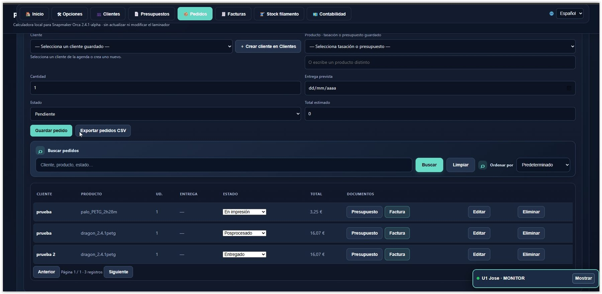

# Print Cost & Profit

## Calculadora de costes, producción y gestión para impresión 3D

Print Cost & Profit ayuda a calcular los costes estimados de fabricación, revisar precios y beneficios, organizar materiales y gestionar información relacionada con trabajos de impresión 3D. Incluye integración con OrcaSlicer y almacenamiento local mediante SQLite.

**Autoría:** Beatriz Toro Martin  
**Sistema de referencia:** Windows 10 y Windows 11  
**Repositorio oficial:** https://github.com/nilose2014/PrintCostProfit

## Características principales

- **Calculadora de costes:** estima los costes de material, tiempo de impresión, uso y desgaste de la impresora y otros gastos configurados.
- **Precio y rentabilidad:** permite revisar coste estimado, precio de venta, beneficio, margen y precio recomendado.
- **Perfiles de impresora:** configura los datos económicos de los equipos.
- **Integración con OrcaSlicer:** procesa archivos G-code mediante un script de posprocesamiento.
- **Almacenamiento local SQLite:** conserva los datos en una base de datos local del ordenador.
- **Herramientas de diagnóstico:** incluye scripts para investigar problemas de inicio e integración.

## Calculadora de costes

La calculadora ayuda a estimar el coste de fabricación antes de decidir el precio de venta. Los resultados dependen de los valores introducidos y de la configuración utilizada.

## Precio, coste y beneficio

Revisa el desglose de costes y los resultados económicos estimados para valorar el precio de venta.

## Perfiles y monitor de impresoras

La configuración de impresoras permite considerar las diferencias entre equipos. Los datos disponibles dependen de los perfiles y componentes instalados.

## Gestión de pedidos

Consulta la información de los pedidos y las funciones de seguimiento disponibles en la aplicación.

## Instalación en Windows

1. Abre el [repositorio oficial](https://github.com/nilose2014/PrintCostProfit).
2. Pulsa **Code → Download ZIP**.
3. Extrae todos los archivos en una carpeta permanente, por ejemplo `C:\PrintCostProfit`.
4. Inicia la aplicación ejecutando `Integracion_Orca_Postprocesado.bat`.

Para las funciones que necesitan almacenamiento local, inicia la aplicación mediante el lanzador. No abras directamente el archivo HTML ni ejecutes el programa desde dentro del ZIP.

## Configurar OrcaSlicer

1. Localiza `Integracion_Orca_Postprocesado.bat` y copia su ruta completa.
2. Abre OrcaSlicer y entra en los ajustes del perfil de impresión.
3. Busca **Otros → Scripts de posprocesamiento** (los nombres pueden variar según la versión).
4. Añade la ruta completa del archivo BAT y guarda el perfil.
5. Lamina un modelo y exporta un G-code para comprobar que el posprocesamiento se ejecuta correctamente.

El procesamiento depende del G-code generado, de la configuración de OrcaSlicer y de los datos disponibles en el archivo. Las estimaciones del laminador no equivalen necesariamente al consumo real confirmado por la impresora.

## Almacenamiento y copias de seguridad

La aplicación utiliza componentes locales basados en SQLite. No elimines ni muevas manualmente la base de datos mientras el servicio está funcionando. Haz una copia de seguridad antes de actualizar.

Si aparece un error de almacenamiento, comprueba el servicio local y utiliza las herramientas de diagnóstico. No borres los datos para intentar resolver el problema ni continúes introduciendo información si no se confirma que se está guardando.

## Diagnóstico

Entre las herramientas incluidas pueden encontrarse:

- `Diagnostico_Arranque.bat`
- `Diagnostico_Print_Cost_Profit.bat`
- `Diagnostico_Version.bat`
- `Probar_Integracion_con_Gcode.bat`

Utiliza los archivos de diagnóstico solo cuando sea necesario y conserva el mensaje de error completo.

## Seguridad y licencia

Descarga el programa desde el repositorio oficial. No compartas contraseñas ni claves privadas, y no expongas el servicio local a Internet sin una configuración de seguridad adecuada.

Consulta `LICENSE.txt` para conocer las condiciones de uso y los derechos de autor aplicables.

## Informar de un problema

Incluye la versión del programa, la versión de Windows y OrcaSlicer, la operación realizada y el mensaje de error completo. No publiques credenciales ni datos personales innecesarios.
