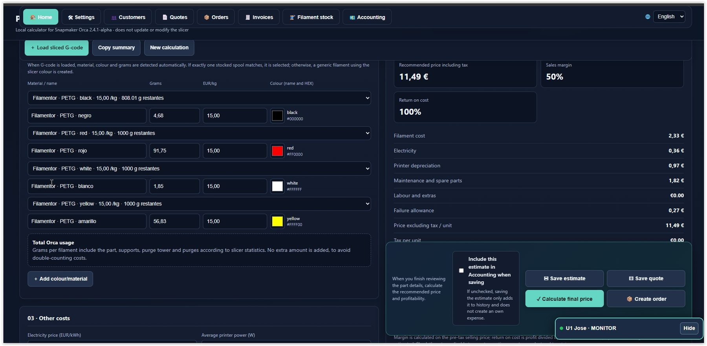
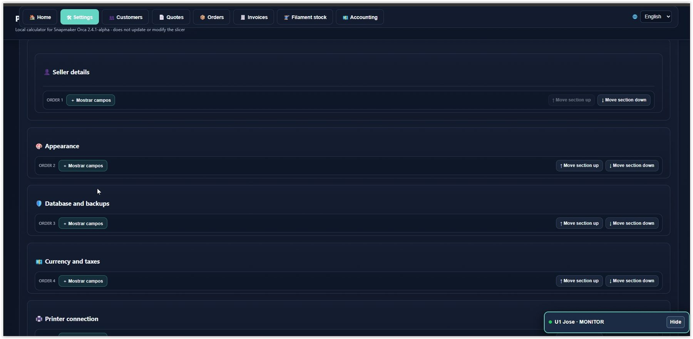
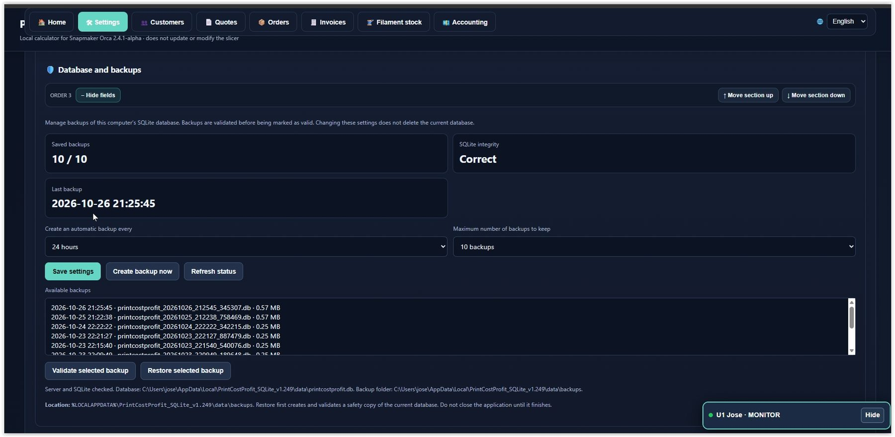
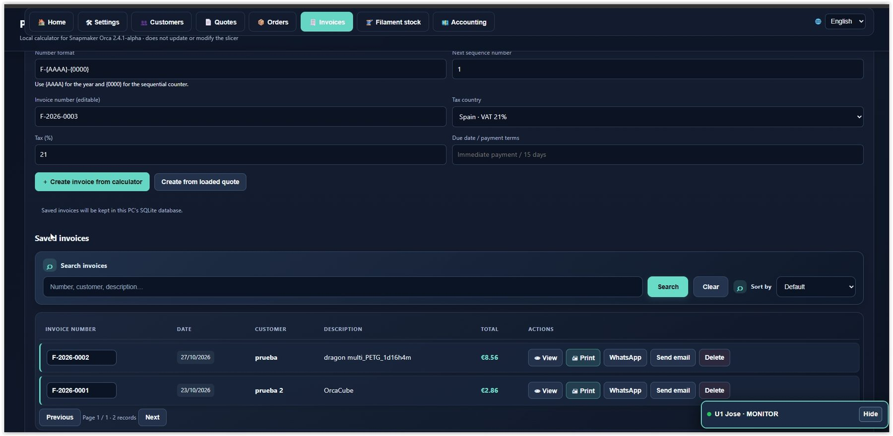

# Print Cost & Profit v1.0

## Cost calculator, production and management for 3D printing

Print Cost & Profit is an application designed to help 3D printing users estimate manufacturing costs, monitor filament consumption, manage materials, and organise the business activity related to their prints.

The application combines a cost calculator with management tools, local storage, and integration with OrcaSlicer-based slicers, especially Snapmaker Orca, OrcaSlicer, and Creality Print. It also includes a printer monitor, with compatibility depending on the printer model and connection method.

## Application screenshots

The screenshots below show several areas of Print Cost & Profit. Available functions depend on the installed version and configuration.

**Author:** Beatriz Toro Martin &#x20;

**Published version:** v1.0 &#x20;

**Reference operating systems:** Windows 10 and Windows 11 &#x20;

**Official repository:** https\://github.com/nilose2014/PrintCostProfit

---

# 1. Main features

## 1.1. 3D printing cost calculator

The calculator estimates the manufacturing cost of a part using print parameters and associated costs.

Depending on the configuration, cost items may include:

- Filament consumption.

- Material price.

- Printing time.

- Printer operating and wear costs.

- Equipment depreciation.

- Other manufacturing-related expenses.

- Desired profit margin.

- Selected taxes and currency.

The goal is to understand how much a part costs to manufacture before setting its selling price.

## 1.2. Selling price, profit and margin

The calculator helps assess the estimated financial outcome of a print.

The calculations help distinguish between:

- **Manufacturing cost:** estimated cost of the resources used.

- **Selling price:** amount intended to be charged for the part.

- **Estimated profit:** calculated difference between revenue and the costs considered.

- **Margin:** relationship between profit and selling price, according to the calculation used.

- **Recommended price:** suggested price calculated from the configured parameters.

Results depend on the prices, percentages, times, and other values entered. Keep filament, printer, and additional costs up to date for useful estimates.

## 1.3. Printer profiles

Profiles let you configure the economic parameters associated with the equipment you use.

Where supported by a profile, these may include purchase cost, estimated service life, and operating costs.

If you use multiple printers, select the correct profile so estimates reflect differences between machines.

## 1.4. OrcaSlicer integration

Print Cost & Profit integrates with OrcaSlicer through post-processing scripts.

This integration processes a G-code file generated by the slicer and uses the available data to support the application workflow.

The information that can be retrieved depends on the generated file, OrcaSlicer settings, and the features available in the installation.

## 1.5. Printer monitor and printer compatibility

The printer confirmed to be **100% compatible** is the **Snapmaker U1**. The monitor also works with other printers, including printers accessible through **Fluidd** or **Mainsail/Moonraker** (depending on their setup), but support for those models is still being refined. Some features may be unavailable or behave differently while testing and adjustments continue.

## 1.6. Local SQLite storage

The application includes local storage components based on SQLite.

The goal is to keep data in a database on the computer and avoid splitting it between PC storage and browser storage.

If local storage cannot start, the application should display the relevant error instead of silently switching to another storage location.

## 1.7. Diagnostic tools

The project includes scripts to help check application startup, the local bridge, and certain integration issues.

These tools provide useful information when a component fails to start or an operation does not complete successfully.

---

# 2. Prerequisites

Before starting the program, make sure you have:

- A computer running Windows 10 or Windows 11.

- A permanent local folder for the project.

- An OrcaSlicer-based slicer—especially Snapmaker Orca, OrcaSlicer, or Creality Print—if you want to use the integration.

- All files from the downloaded distribution.

- The storage and configuration components included in the distribution package.

The distribution should include the SQLite executable prepared for Windows so end users do not need to install Python manually.

Do not run the application directly from the ZIP file. Extract all files first.

---

# 3. Download and install Print Cost & Profit

## Step 1. Download the program

1. Open the official repository:

   https\://github.com/nilose2014/PrintCostProfit

2. Click **Code**.

3. Select **Download ZIP**.

4. Wait for the download to finish.

5. Extract the ZIP contents.

## Step 2. Choose a folder

You can use a folder such as:

`C:\PrintCostProfit`

You can choose another permanent location. Avoid temporary folders, and do not move the program after configuring OrcaSlicer paths unless you update those paths.

## Step 3. Start the program

Open the folder where you extracted the files and double-click:

**`Integracion_Orca_Postprocesado.bat`**

This file is used both to start the application manually and for OrcaSlicer integration.

When run manually, it checks whether the local service is available. If it does not respond, it attempts to start it and waits until it is ready before opening the interface in the browser.

You do not need to open the HTML file first or start the local bridge separately when the launcher can handle this.

**Important:** to use features that require local storage, start the application with this file instead of opening `Print_Cost_Profit.html` directly.

---

# 4. Configure an OrcaSlicer-based slicer

The integration is intended for OrcaSlicer-based slicers, especially Snapmaker Orca, OrcaSlicer, and Creality Print. Menu names and details may differ between them. Overall compatibility is approximately 90%, so test it with your installed version.

The post-processing script processes G-code when the slicer finishes slicing.

## Step 1. Locate the integration file

In the program folder, locate:

`Integracion_Orca_Postprocesado.bat`

Copy its full path. If you used the example folder, it will be:

`C:\PrintCostProfit\Integracion_Orca_Postprocesado.bat`

If you installed the program elsewhere, use the actual path.

## Step 2. Open print settings

1. Open OrcaSlicer.

2. Select the printer profile you want to use.

3. Open the print settings.

4. Enable Advanced or Expert mode if needed.

5. Open the **Others** section.

6. Find **Post-processing scripts**.

Menu names and layouts may vary by slicer, version, and selected language.

## Step 3. Add the script

Enter the full path to:

`Integracion_Orca_Postprocesado.bat`

Save the profile settings.

If your slicer requires a specific path or argument syntax, use the format appropriate for that version.

## Step 4. Run a test

1. Load a simple model.

2. Select the printer and print profile.

3. Configure the material.

4. Slice the model.

5. Export the G-code.

6. Check that post-processing runs without errors.

The script processes the G-code file when OrcaSlicer calls it with the file path. In this case, it behaves differently from manual startup: it processes the file and exits without opening a second application window.

---

# 5. Processing G-code files

G-code contains instructions generated by the slicer for the 3D printer.

Print Cost & Profit integration processes these files to retrieve available data useful for calculations and job records.

Depending on the file contents and available features, relevant data may include:

- File name or path.

- Print information generated by the slicer.

- Estimated time and material usage.

- Filament information when available.

Values from G-code are slicing estimates and should not automatically be treated as actual consumption confirmed by the printer.

## Manual G-code test

The project includes:

`Probar_Integracion_con_Gcode.bat`

To run a test:

1. Find a G-code file generated by the compatible slicer you are using.

2. Drag the file onto `Probar_Integracion_con_Gcode.bat`.

3. Wait for the process to finish.

4. Check the result and any error messages.

This test helps distinguish a file-processing problem from a local service problem.

---

# 6. Cost and profitability management\n\n

For useful results, configure the financial data before calculating a part price.

## Filament

Keep the price of each material up to date. Changes in price per kilogram can significantly affect manufacturing costs.

## Printer

Use the profile for the machine that will make the part. Depreciation and wear parameters should be based on reasonable cost and service-life estimates.

## Manufacturing time

The slicer time estimate helps calculate machine-use costs. Actual results may vary due to pauses, material changes, failures, or differences between estimated and actual time.

## Additional expenses

Include job-related expenses that are supported by the calculator configuration.

## Selling price

Review the recommended price alongside cost, profit, and margin. A calculated price is only as reliable as the data entered.

---

# 7. Data storage and retention

Print Cost & Profit uses a local service and an SQLite database for features that depend on this storage.

The installation’s data location may be inside the Windows user’s local profile.

## Recommendations

- Do not delete the database while the service is running.

- Do not manually move the data folder.

- Back up your data before updating the program.

- Check that the local service starts correctly after an update.

- Verify that data remains available after closing and reopening the application.

## If a storage error appears

If the application reports that PC storage cannot start, do not continue entering data as though it were being saved correctly.

Check the local service and use the diagnostic tools. Do not delete the database to try to fix the problem.

The protection against silently switching to browser storage is designed to prevent data from being split across two locations.

---

# 8. Included scripts and tools\n\n

The repository contains various supporting files. Not all of them need to be run manually during normal use.

| File | Purpose |

|---|---|

| `Integracion_Orca_Postprocesado.bat` | Starts the application manually and serves as the post-processing entry point for compatible OrcaSlicer-based slicers. |

| `Iniciar_Puente_Orca.ps1` | Starts or checks the integration bridge. |

| `Iniciar_Puente_Orca_Independiente.cmd` | Standalone launcher for the local bridge. |

| `Integracion_Print_Cost_Profit.ps1` | Processes integration using the G-code file. |

| `Probar_Integracion_con_Gcode.bat` | Manually tests G-code processing. |

| `Comprobar_Puente_U1.bat` | Checks the bridge related to the Snapmaker U1. |

| `Diagnostico_Arranque.bat` | Helps investigate startup problems. |

| `Diagnostico_Print_Cost_Profit.bat` | Application diagnostic tool. |

| `Diagnostico_Version.bat` | Checks version information. |

| `pcp_sqlite_api.py` | SQLite storage service code. |

| `pcp_sqlite_store.py` | SQLite storage access and management component. |

| `storage-client.js` | Client used by the interface to communicate with storage. |

| `VERSION` | Project version information. |

| `LICENSE.txt` | Terms of use and copyright notice. |

The availability and exact behaviour of each feature depend on the files included in the distribution and their configuration.

---

# 9. Troubleshooting

## The application does not open

1. Make sure you extracted all files.

2. Run `Integracion_Orca_Postprocesado.bat`.

3. Wait for the local service to respond.

4. If it does not open, run `Diagnostico_Arranque.bat`.

5. Keep the full error message.

## PC storage does not start

Check that the package includes the SQLite executable for Windows and that it is in the location expected by the server.

If an HTTP 500 error appears, check the service status and diagnostic messages before trying to modify data.

Do not switch to browser storage or delete the database as a workaround.

## The slicer does not run the integration

1. Verify the path to the `.bat` file.

2. Check that the file exists.

3. Review the print profile settings.

4. Test with `Probar_Integracion_con_Gcode.bat`.

5. Keep the error and the path of the G-code used.

## Data is not retained

Check that you started the application with the launcher and that the local service is running.

Then test with non-critical data and verify that it remains after restarting the application.

Do not delete existing data to try to repair storage.

---

# 10. Security and best practices

- Download the program from the official repository.

- Do not share passwords, private keys, or credentials.

- Do not run scripts from unknown sources.

- Do not expose the local service to the internet without appropriate security configuration.

- Keep backups of important data.

- Check dependencies and program operation before replacing files during an update.

---

# 11. Copyright and terms of use

Print Cost & Profit is subject to the terms set out in `LICENSE.txt`.

Publishing the code on GitHub does not by itself grant permission to market, resell, sublicense, redistribute, or commercially exploit the software, modified versions, or derivative products where such activities are prohibited by the applicable licence.

Requests for permission must be made in writing and expressly accepted by the rights holder.

---

# 12. Help and issue reporting

When reporting a problem, include:

- Print Cost & Profit version.

- Windows version.

- Slicer name and version (Snapmaker Orca, OrcaSlicer, Creality Print, or another slicer).

- Printer used, if relevant.

- Operation performed.

- Full error message.

- Steps to reproduce the problem.

Do not include passwords, private keys, or unnecessary personal information.

---

**Print Cost & Profit v1.0** &#x20;

Developed by Beatriz Toro Martin.

&#x20; Calculate your costs, track your jobs, and improve the financial management of your 3D printing work.   &#x20;
