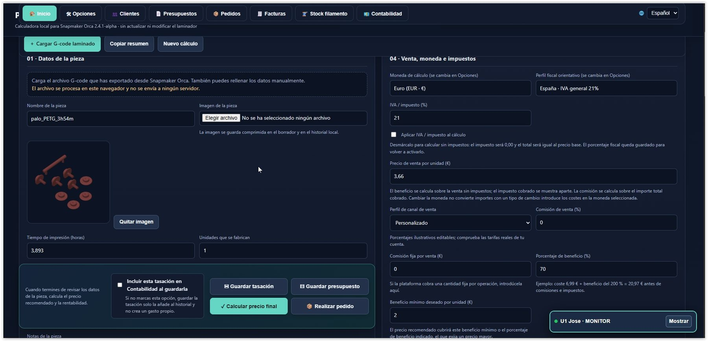
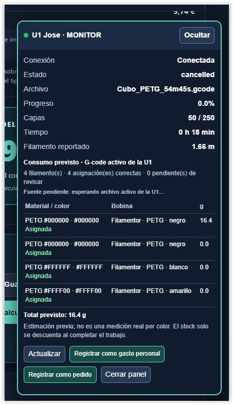
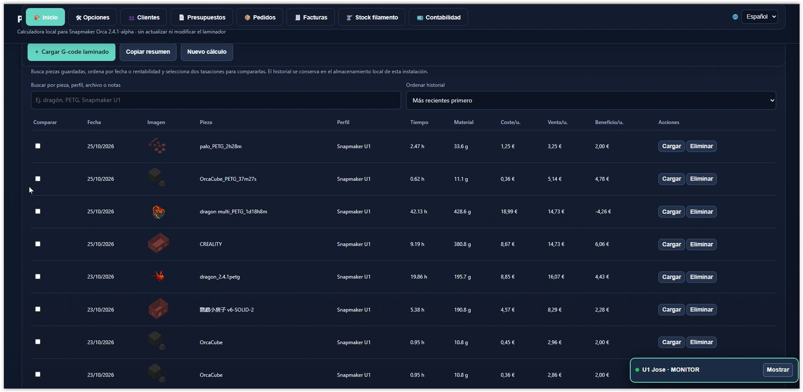
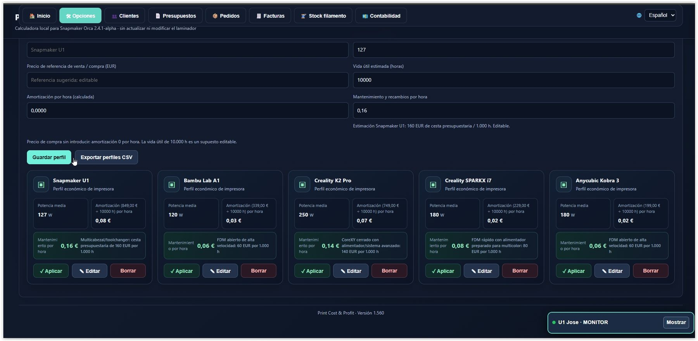
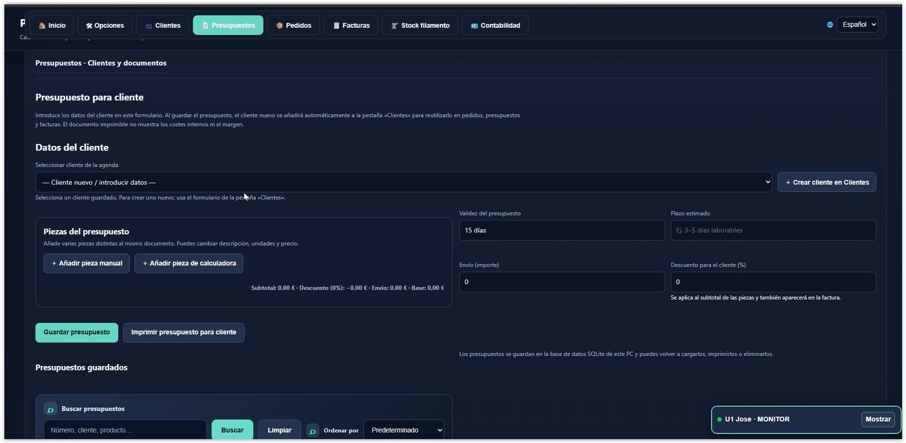
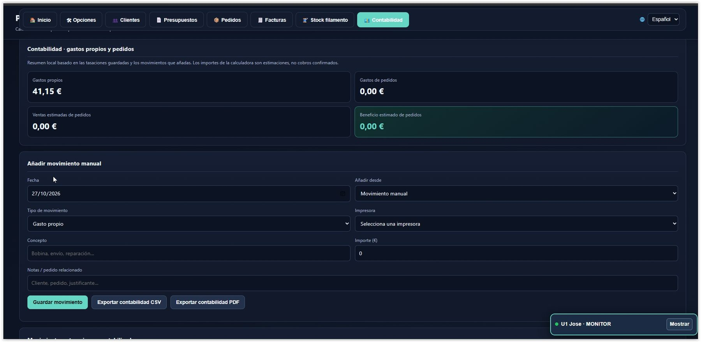

# 快速安装

请选择与您的操作系统对应的软件包：

### Windows 10 / 11 — 稳定版本 v1.2

- **[下载 Windows v1.2 安装程序](https://github.com/nilose2014/PrintCostProfit/releases/download/v1.2/PrintCostProfit-Windows-Installer-v1.2.zip)**。
- 解压 ZIP 文件并运行 `PrintCostProfit-Setup-1.2.exe`。
- 按照安装程序中的步骤操作。然后使用创建的快捷方式启动 Print Cost & Profit。
- 安装程序包含本地 SQLite 存储所需的组件；无需手动安装 Python。

**Windows 仓库：** [PrintCostProfit — 主分支](https://github.com/nilose2014/PrintCostProfit)。如果您希望从源代码安装，请进入 **Code → Download ZIP**，将所有文件解压到一个固定文件夹，然后运行 `Integracion_Orca_Postprocesado.bat`。

### Linux / Ubuntu — 稳定版本

- **[下载 Linux 稳定版本](https://github.com/nilose2014/PrintCostProfit/releases/tag/linux-preview-0.1)**。
- 解压下载的 ZIP 文件。
- 按照软件包中提供的安装和启动说明操作。

**Linux 仓库 / 版本：** [PrintCostProfit — Linux](https://github.com/nilose2014/PrintCostProfit/tree/linux)。

---

# Print Cost & Profit v1.2

## 3D 打印成本、生产与管理计算器

Print Cost & Profit 是一款应用程序，旨在帮助 3D 打印用户计算实际制造成本、监控耗材使用量、管理材料，并组织与打印业务相关的商业活动。

该应用将成本计算器与管理工具、本地存储以及基于 OrcaSlicer 的切片软件集成在一起，尤其支持 Snapmaker Orca、OrcaSlicer 和 Creality Print。此外，它还包含兼容打印机的监控器，具体兼容程度取决于打印机型号和可用连接方式。

## 应用程序截图

以下图片展示了 Print Cost & Profit 的部分界面。这些图片说明了不同的界面区域；可用功能取决于已安装的版本和配置。

**作者：** Beatriz Toro Martin

**已发布版本：** v1.2

**参考操作系统：** Windows 10 和 Windows 11

**官方仓库：** https://github.com/nilose2014/PrintCostProfit

---

# 1. 主要功能

## 1.1. 3D 打印成本计算器

计算器可根据打印参数及相关成本估算零件的制造成本。

根据可用配置，可以使用以下成本项目：

- 耗材用量。
- 所用材料的价格。
- 打印时间。
- 打印机运行和损耗成本。
- 设备折旧。
- 其他制造相关费用。
- 期望利润率。
- 所选税费和货币。

其目的是在确定零件售价之前，了解制造该零件需要多少成本。

## 1.2. 售价、利润和利润率

计算器可用于分析一次打印任务的预计经济结果。

计算结果有助于区分以下概念：

- **制造成本：** 所用资源的估算价值。
- **售价：** 计划向客户收取的零件金额。
- **预计利润：** 收入与所考虑成本之间的计算差额。
- **利润率：** 根据计算所采用的定义，利润与售价之间的比例。
- **建议价格：** 根据已配置参数计算出的建议售价。

结果取决于输入的价格、百分比、时间和其他数值。为了获得有用的估算，请及时更新耗材、打印机和额外费用的成本。

## 1.3. 打印机配置文件

配置文件可用于设置所用设备相关的经济参数。

如果配置文件中包含这些项目，则可以考虑设备购置成本、预计使用寿命和运行成本等数据。

如果使用多台打印机，请选择相应的配置文件，以便估算结果反映不同设备之间的差异。

## 1.4. 与切片软件的兼容性

该集成面向基于 OrcaSlicer 的切片软件，尤其是 **Snapmaker Orca、OrcaSlicer 和 Creality Print**。与这些软件的兼容程度约为 **90%**；具体行为仍可能因版本和配置而异。因此，不应将其描述为 100% 兼容。

通过后处理脚本，可以处理切片软件生成的 G-code 文件，并在 Print Cost & Profit 工作流程中使用可获取的数据。能够读取的信息取决于文件、配置和切片软件版本。

## 1.5. 打印机监控与兼容性

已确认达到 **100%** 兼容的打印机是 **Snapmaker U1**。监控器也可与其他能够通过 **Fluidd** 或 **Mainsail/Moonraker** 访问的打印机配合使用（具体取决于配置），但这些型号的支持仍在完善中。测试继续进行期间，部分功能可能不可用或表现不同。

## 1.6. SQLite 本地存储

应用包含基于 SQLite 的本地存储组件。

其目标是在计算机上的数据库中保存数据，而不是将数据分散在电脑和浏览器之间。

如果本地存储无法启动，应用应显示相应错误，而不是在不提示用户的情况下切换到其他存储系统。

## 1.7. 诊断工具

项目包含一些脚本，可帮助检查应用启动、本地桥接服务运行情况以及某些集成问题。

当某个组件无法启动或某项操作未能正确完成时，这些工具可以提供有用的信息。

---

# 2. 前置要求

启动程序之前，建议准备：

- 一台运行 Windows 10、Windows 11 或 Linux 的计算机。
- 一个用于安装项目的固定本地文件夹。
- 如果需要使用集成功能，请准备基于 OrcaSlicer 的切片软件，尤其是 Snapmaker Orca、OrcaSlicer 或 Creality Print。
- 下载的软件包中的全部文件。
- 软件包中包含的存储和配置组件。

软件包应包含为 Windows 准备的 SQLite 可执行文件，以免最终用户必须手动安装 Python。

不要直接从 ZIP 文件中运行应用。请先解压所有文件。

---

# 3. 下载并安装 Print Cost & Profit

## 步骤 1. 下载程序

1. 打开官方仓库：

   Windows：https://github.com/nilose2014/PrintCostProfit；Linux：https://github.com/nilose2014/PrintCostProfit/releases/tag/linux-preview-0.1

2. 点击 **Code**。
3. 选择 **Download ZIP**。
4. 等待下载完成。
5. 解压 ZIP 文件内容。

## 步骤 2. 选择文件夹

您可以使用以下文件夹：

`C:\PrintCostProfit`

也可以选择其他固定位置。请避免使用临时文件夹。配置 OrcaSlicer 路径后，不要移动程序，除非同时更新这些路径。

## 步骤 3. 启动程序

打开解压文件的文件夹，然后双击：

**`Integracion_Orca_Postprocesado.bat`**

此文件既可用于手动启动，也可用于与 OrcaSlicer 集成。

手动运行时，它会检查本地服务是否可用。如果服务没有响应，脚本会尝试启动服务，并等待服务就绪后再在浏览器中打开界面。

如果启动器能够完成这些操作，则无需先打开 HTML 文件，也无需单独启动本地桥接服务。

**重要提示：** 要使用需要本地存储的功能，请通过此文件启动应用，而不要直接打开 `Print_Cost_Profit.html`。

---

# 4. 配置基于 OrcaSlicer 的切片软件

该集成适用于基于 OrcaSlicer 的切片软件，尤其是 Snapmaker Orca、OrcaSlicer 和 Creality Print。菜单名称和部分细节可能有所不同。总体兼容程度约为 90%，因此建议使用已安装的版本进行测试。

切片软件完成切片后，集成会使用后处理脚本处理 G-code。

## 步骤 1. 找到集成文件

在程序文件夹中找到：

`Integracion_Orca_Postprocesado.bat`

复制完整路径。如果使用示例文件夹，路径为：

`C:\PrintCostProfit\Integracion_Orca_Postprocesado.bat`

如果程序安装在其他位置，请使用实际路径。

## 步骤 2. 打开打印设置

1. 打开 OrcaSlicer。
2. 选择要使用的打印机配置文件。
3. 打开打印设置。
4. 如有需要，启用高级或专家模式。
5. 打开 **其他** 部分。
6. 找到 **后处理脚本**。

菜单名称和布局可能因切片软件、版本和所选语言而异。

## 步骤 3. 添加脚本

输入以下文件的完整路径：

`Integracion_Orca_Postprocesado.bat`

保存配置文件设置。

如果切片软件要求路径或参数使用特定语法，请使用该版本对应的格式。

## 步骤 4. 执行测试

1. 加载一个简单模型。
2. 选择打印机和打印配置文件。
3. 配置材料。
4. 对模型进行切片。
5. 导出 G-code。
6. 检查后处理是否在没有错误的情况下执行。

当 OrcaSlicer 使用文件路径调用脚本时，脚本会处理 G-code 文件。在这种情况下，其行为与手动启动不同：脚本处理文件后结束，不会再打开第二个应用程序窗口。

---

# 5. G-code 文件处理

G-code 包含切片软件为 3D 打印机生成的指令。

Print Cost & Profit 集成可以处理这些文件，以获取可用于计算和任务记录的数据。

根据文件中包含的信息和可用功能，相关数据可能包括：

- 文件名或路径。
- 切片软件生成的打印信息。
- 预计时间和材料消耗。
- 可用时的耗材信息。

从 G-code 获取的数值是切片估算值。不得自动将其视为打印机确认的实际消耗量。

## 使用 G-code 文件进行手动测试

项目包含：

`Probar_Integracion_con_Gcode.bat`

执行测试的步骤：

1. 找到由您正在使用的兼容切片软件生成的 G-code 文件。
2. 将文件拖放到 `Probar_Integracion_con_Gcode.bat` 上。
3. 等待处理完成。
4. 检查结果和任何错误消息。

此测试有助于区分文件处理问题和本地服务问题。

---

# 6. 成本与盈利能力管理 

为了获得有用的结果，请在计算零件价格之前配置财务数据。

## 耗材

及时更新每种材料的价格。每公斤价格的变化可能会显著影响所制造零件的成本。

## 打印机

使用实际制造零件的设备配置文件。折旧和损耗参数应基于合理的成本和使用寿命估算。

## 制造时间

切片软件估算的时间可用于估算机器使用成本。由于暂停、材料更换、故障或预计时间与实际时间之间的差异，实际结果可能有所不同。

## 额外费用

加入适用于该任务且已包含在计算器配置中的费用。

## 售价

结合成本、利润和利润率检查建议价格。计算价格的可靠性取决于输入数据的质量。

---

# 7. 数据存储与保留

Print Cost & Profit 使用本地服务和 SQLite 数据库，为依赖此存储方式的功能提供支持。

安装程序使用的存储位置可能位于 Windows 本地用户配置文件中。

## 建议

- 服务运行时不要删除数据库。
- 不要手动移动数据文件夹。
- 更新程序之前，请备份数据。
- 更新后检查本地服务是否正常启动。
- 关闭并重新打开应用后，检查数据是否仍然保留。

## 如果出现存储错误

如果应用提示无法启动 PC 存储，请不要继续输入数据并假定数据已正确保存。

检查本地服务并使用诊断工具。不要通过删除数据库来尝试解决问题。

防止静默切换到浏览器存储的保护机制，旨在避免数据被分散到两个不同的位置。

---

# 8. 附带的脚本和工具 

仓库包含多个辅助文件。正常使用时，并非所有文件都需要手动运行。

| 文件 | 功能 |
|---|---|
| `Integracion_Orca_Postprocesado.bat` | 手动启动应用，并作为兼容的 OrcaSlicer 系切片软件后处理入口。 |
| `Iniciar_Puente_Orca.ps1` | 启动或检查集成桥接服务。 |
| `Iniciar_Puente_Orca_Independiente.cmd` | 本地桥接服务的独立启动程序。 |
| `Integracion_Print_Cost_Profit.ps1` | 处理与 G-code 文件的集成。 |
| `Probar_Integracion_con_Gcode.bat` | 手动测试 G-code 处理。 |
| `Comprobar_Puente_U1.bat` | 检查与 Snapmaker U1 相关的桥接服务。 |
| `Diagnostico_Arranque.bat` | 帮助排查启动问题。 |
| `Diagnostico_Print_Cost_Profit.bat` | 应用诊断工具。 |
| `Diagnostico_Version.bat` | 检查版本信息。 |
| `pcp_sqlite_api.py` | SQLite 存储服务代码。 |
| `pcp_sqlite_store.py` | SQLite 存储访问和管理组件。 |
| `storage-client.js` | 界面用于与存储服务通信的客户端。 |
| `VERSION` | 项目版本信息。 |
| `LICENSE.txt` | 使用条款和版权声明。 |

每项功能是否可用以及具体行为，取决于软件包中包含的文件及其配置。

---

# 9. 故障排除

## 应用无法打开

1. 检查是否已解压所有文件。
2. 运行 `Integracion_Orca_Postprocesado.bat`。
3. 等待本地服务响应。
4. 如果应用没有打开，请运行 `Diagnostico_Arranque.bat`。
5. 保存完整的错误消息。

## PC 存储无法启动

检查软件包是否包含适用于 Windows 的 SQLite 可执行文件，以及该文件是否位于服务器预期的位置。

如果出现 HTTP 500 错误，请先检查服务状态和诊断消息，再尝试修改数据。

不要切换到浏览器存储，也不要将删除数据库作为临时解决办法。

## 切片软件没有执行集成

1. 检查 `.bat` 文件的路径。
2. 确认文件存在。
3. 检查打印配置文件设置。
4. 使用 `Probar_Integracion_con_Gcode.bat` 进行测试。
5. 保存错误消息和所用 G-code 文件的路径。

## 数据没有保留

检查是否通过启动器运行应用，以及本地服务是否正在运行。

然后使用非关键数据进行测试，并检查应用重新启动后数据是否仍然保留。

不要通过删除现有数据来尝试修复存储。

---

# 10. 安全与最佳实践

- 从官方仓库下载程序。
- 不要分享密码、私钥或登录凭据。
- 不要运行来源不明的脚本。
- 未进行适当的安全配置时，不要将本地服务暴露到互联网。
- 保留重要数据的备份。
- 更新时替换文件之前，请检查依赖项和程序运行情况。

---

# 11. 版权与使用条款

Print Cost & Profit 受 `LICENSE.txt` 中所列条款约束。

仅仅将代码发布到 GitHub，并不意味着获得了营销、转售、再许可、重新分发或商业利用该软件、修改版本或衍生产品的授权；如果适用许可证禁止这些活动，则不得进行这些活动。

授权申请必须以书面形式提出，并由权利持有人明确接受。

---

# 12. 帮助与问题报告

报告问题时，请提供：

- Print Cost & Profit 版本。
- Windows 版本。
- 切片软件名称和版本（Snapmaker Orca、OrcaSlicer、Creality Print 或其他软件）。
- 使用的打印机（如相关）。
- 执行的操作。
- 完整的错误消息。
- 重现问题的步骤。

请勿提供密码、私钥或不必要的个人数据。

---

**Print Cost & Profit v1.2**

由 Beatriz Toro Martin 开发。

计算成本、跟踪任务并改善财务管理。
