# Print Cost & Profit screenshot gallery

These screenshots show different screens and features of Print Cost & Profit. Captions summarize what is visible in each image.

## Cost calculator

Estimate the cost of a print using configured inputs such as material, time, and manufacturing costs.

## Cost result and profit

Review the suggested price and cost breakdown to evaluate margin and profit.

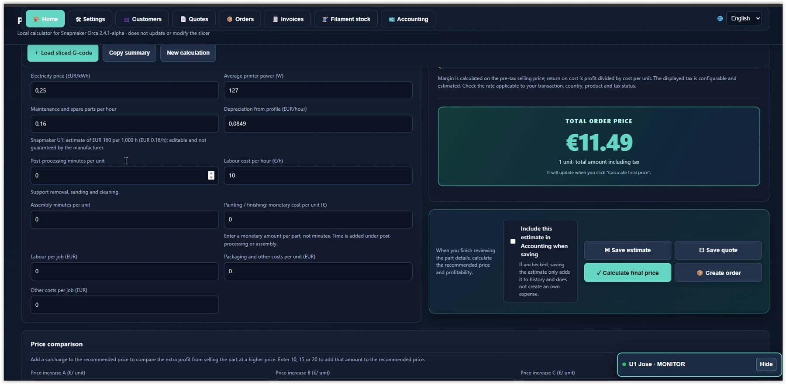

## Floating print panel

Compact panel for checking print-related information while working.

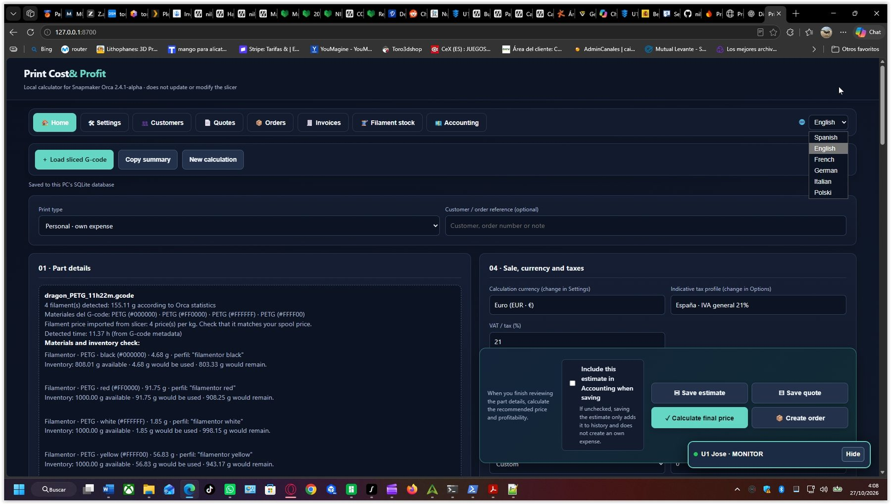

## Product inventory

Browse registered products, their main details, and available management actions.

## Estimate configuration

Enter the part details and parameters needed to calculate its cost.

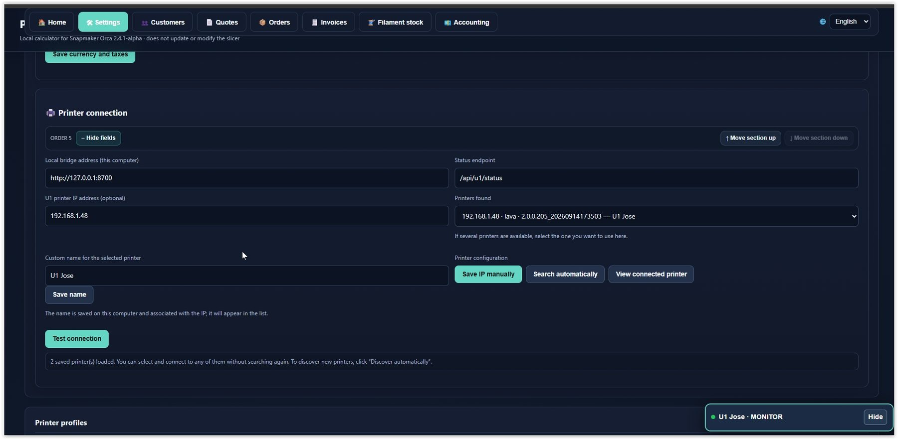

## Printer profiles and monitoring

View printer profiles and available tracking information for each machine.

## Customer and document details

Enter or review customer information associated with commercial documents.

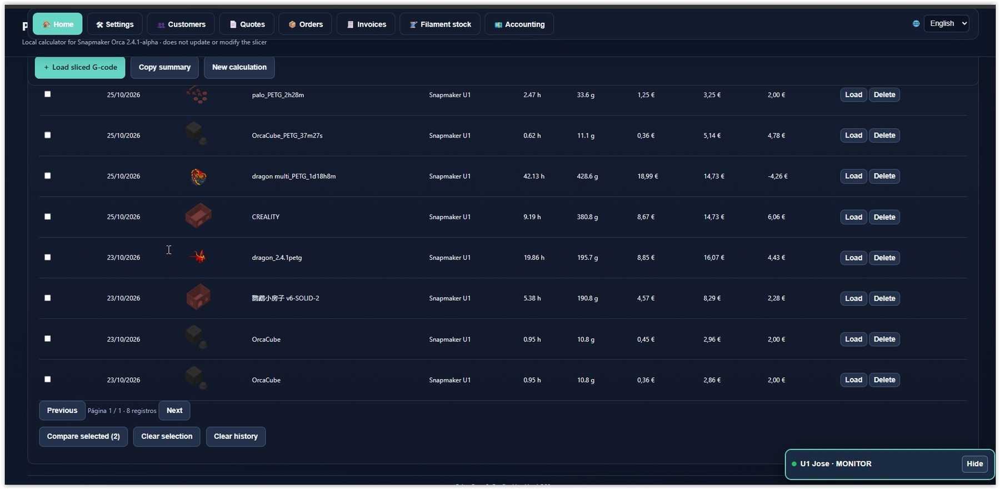

## Quotes and estimates

Manage quotes and their details, with options to save and review records.

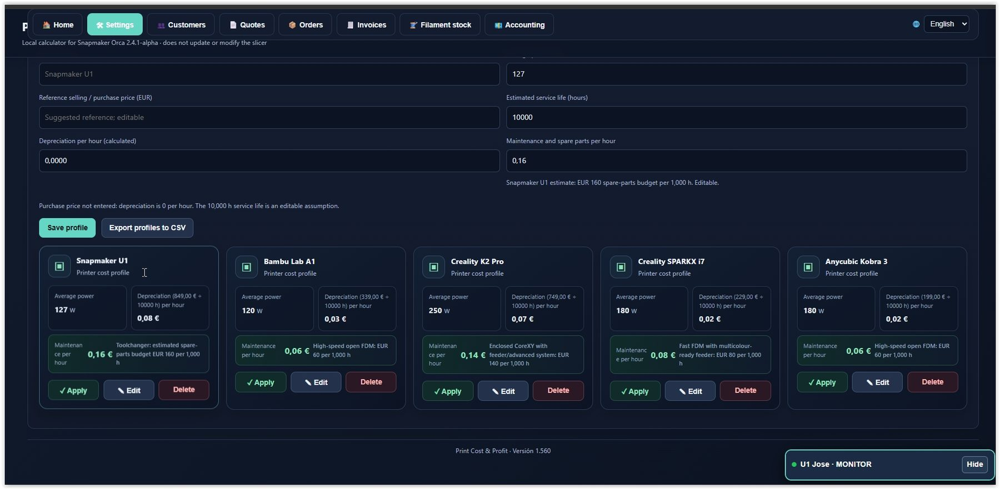

## Settings and preferences

Configure different application parameters.

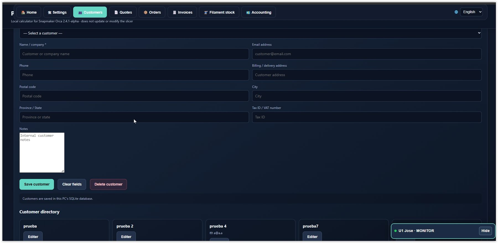

## Order management

Review registered orders and their tracking information.

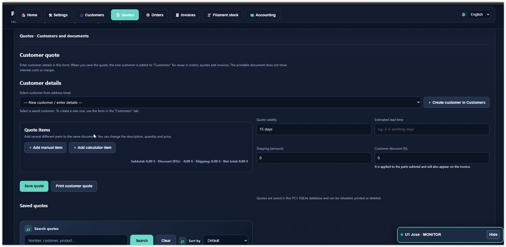

## Records and expenses

Review saved financial entries and records in a table.

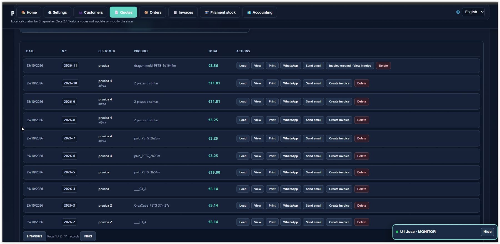

## Colours and materials

Configure materials, colours, and data used by the calculator.

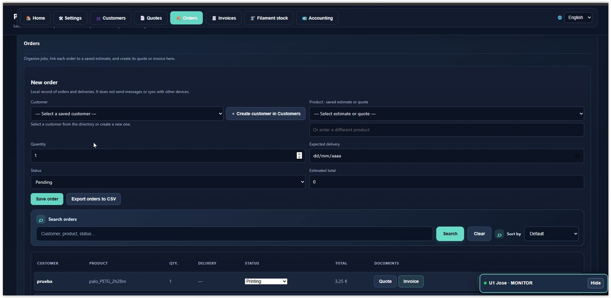

## Saved records list

Browse saved records and the actions available for each one.

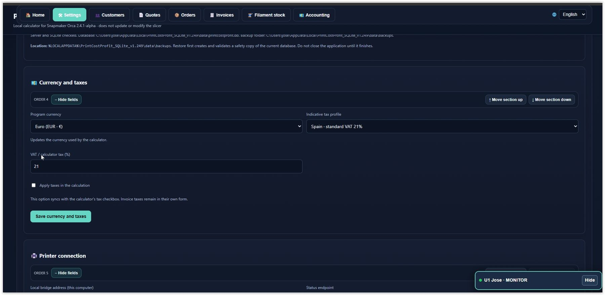

## Cost summary

Review calculated amounts and financial fields for an estimate.

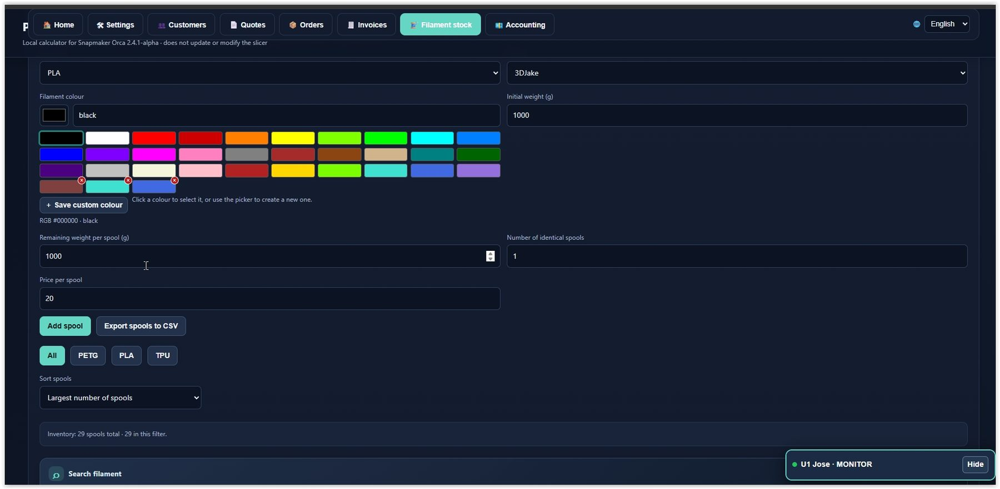

## Quote or order details

View a record’s details, amounts, and management options.

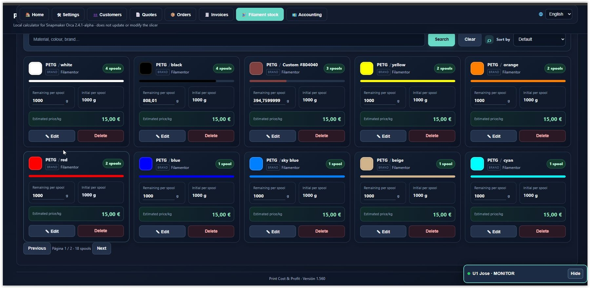

## Personal expenses

Review recorded expenses and their financial information.

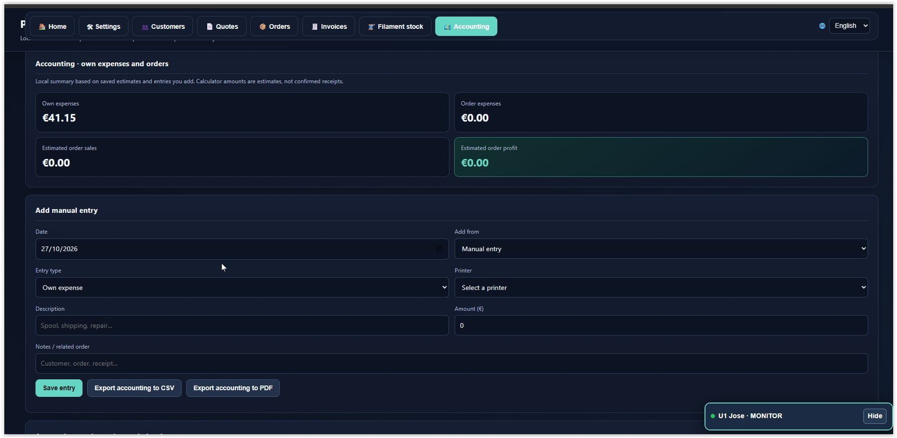

## Order tracking

View orders, their information, and statuses for easier tracking.

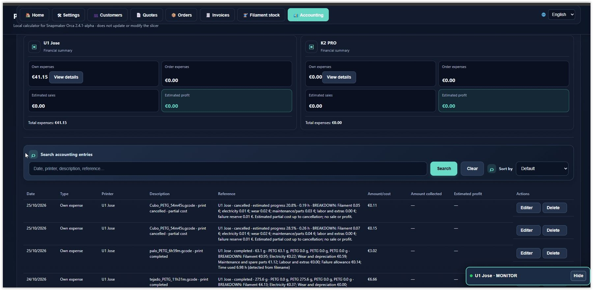

## Filament profiles

View spools or materials with their colours and related details.

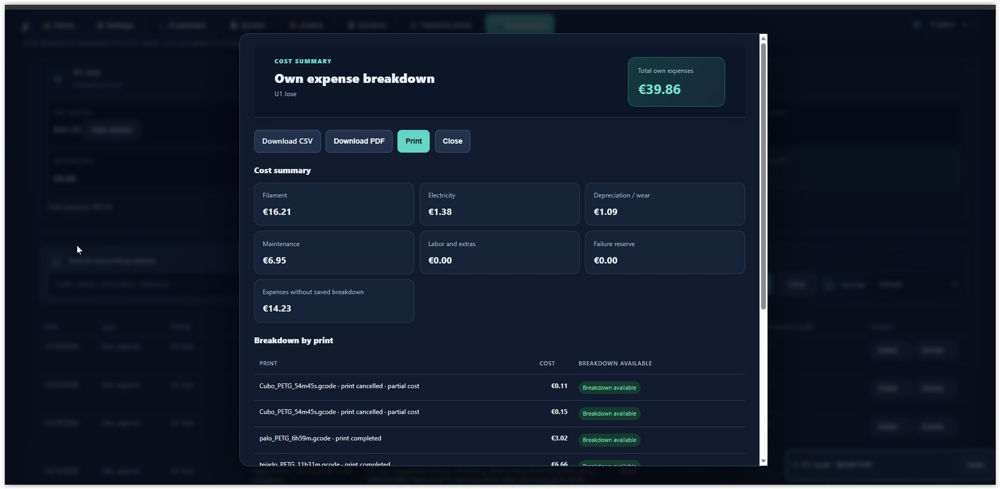

## Documentation and help

Information section with usage instructions and explanations.

